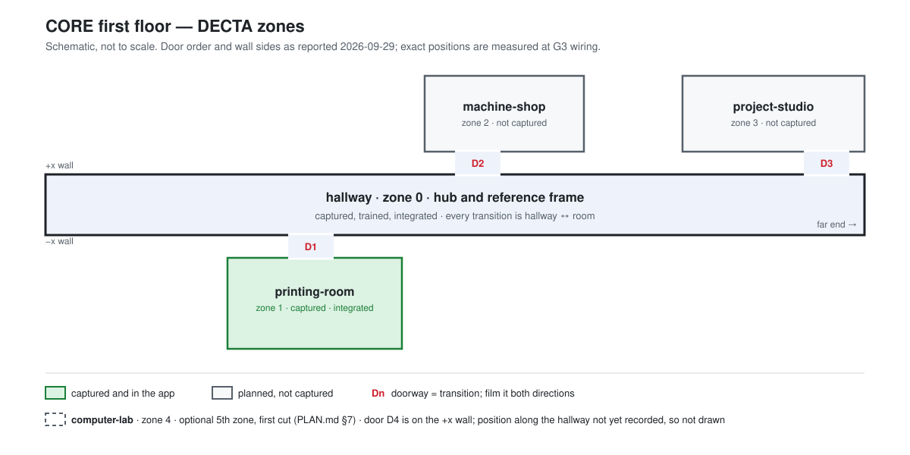

# Zones — CORE first floor

**Final scope addendum — 2026-10-30:** the current deliverable is exactly `hallway`, `printing-room` and `project-studio`. Machine Shop and Computer Lab are excluded for this cohort and retained below as possible future-group work. They are not completion blockers.

Historical #28 defined five possible zones for the original G3 plan. That research and the original schedule remain in `PLAN.md`; this addendum supersedes their active zone-count assumptions without deleting them.

Topology is a star: the hallway is the hub and the shared reference frame, and every transition is
hallway ↔ room. Boundaries sit at doorway chokepoints so each training run stays inside the 8 GB
VRAM ceiling.

## Marked-up plan

Historical five-zone planning schematic, not to scale: it records the earlier room/door hypotheses. Only hallway, printing room and Room 116 are active in the current deliverable; D2/D4 remain future-cohort reference. It is an SVG so anyone can edit it in a text editor. A photo of the posted evacuation map
can replace it later without changing anything else in this file.

## Zone list

| # | id | Label | Status | Splat file |
|---|----|-------|--------|------------|
| 0 | `hallway` | CORE Hallway | Captured, trained, integrated (hub, reference frame) | `hallway.compressed.ply` |
| 1 | `printing-room` | 3D Printing Room | Captured, trained, aligned, integrated, NPCs in | `printing-room-updated.compressed.ply` |
| 3 | `project-studio` | Project Studio — Room 116 | Implemented/published at D3; 41/41 stage and 14/14 integrated Chrome checks user-approved; NPCs outstanding (#56) | `project-studio.compressed.ply` |

### Future-cohort records — excluded from current deliverable

| Historical # | id | Label | Status |
|---|---|---|---|
| 2 | `machine-shop` | Machine Shop | Excluded for this cohort; preserve recapture research (#49) and guide concepts (#55) |
| 4 | `computer-lab` | Computer Lab | Excluded for this cohort; earlier optional-zone concept retained for future groups |

The historical numbering is retained; only the three rows in the active zone table are runtime environments.

Ids are short, lowercase, hyphenated, and must match the `id` in `public/zones.json` and the splat
filename prefix. The splat must end in `.compressed.ply` or Git silently ignores it.

## Hallway starting experience

The visitor starts at the hallway origin with `spawn: [0, 0, 0]`. The team retained this
middle-of-hallway position because it gives the clearest route into the current tour content instead
of placing the visitor at the physical entrance. `spawnYaw: 180` turns the initial view toward
positive Z, with the 3D Printing Room doorway ahead at z 4.80–6.55.

`spawnYaw` is an optional per-zone angle in degrees. `src/main.js` converts it to radians and assigns
it to `controls.yaw` when the initial zone loads; zones without the field keep the controls' default
yaw of 0 degrees, which faces negative Z. The setting changes horizontal direction only and preserves
the existing camera pitch and mouse-look behavior.

The CORE Guide marker is at `[0, 1.6, -3]`, behind the initial view. Its automatic welcome still
opens when the hallway first loads. After closing it, visitors face the printing room and can turn
around and approach the marker to replay the guide with E.

## Doorways off the hallway

**D1 and D3 are the active transitions.** D2/D4 remain historical location hypotheses only; they require no capture, measurement or wiring for this cohort. The original pipeline called for filming active doorways from both directions; D3's original filming provenance has not been reverified (#50), despite successful alignment/browser acceptance. Excluded doors remain behind their existing hallway collision walls.

Positions are in app coordinates: hallway spawn is the origin, z runs along the hallway
(~−20.2 m to ~19.0 m, the measured 128 ft), the two long walls sit at x ≈ −1.1 and x ≈ +1.1.

| # | Leads to | Wall | z range (m) | Filmed both ways | Wired in `zones.json` |
|---|----------|------|-------------|------------------|-----------------------|
| D1 | `printing-room` | −x | 4.80 – 6.55 | Yes (aligned 2026-09-24) | Yes |
| D2 (future cohort only) | `machine-shop` | +x | Historical hypothesis: slightly past D1; exact range unmeasured | No | No |
| D3 | `project-studio` | +x | 16.155668 – 17.923910 (manual jamb picks) | Not reverified | Yes; stage and integrated Chrome entry/return approvals |
| D4 (future cohort only) | `computer-lab` | +x | Historical order along hallway not recorded; exact range unmeasured | No | No |

Historical observation (Johnny, 2026-09-29): D2/D3/D4 are on the +x wall opposite printing room and inside the captured hallway. Only D3 became an active transition; this observation is not a request to integrate D2/D4.

**Historical rationale for measuring z ranges at G3:** they are only consumed when a transition is wired, and they are
read off the already-shipped hallway splat, the same way D1 was aligned on 2026-09-24. Measuring
them now would not save that step. What *did* need settling at G2 is that every door is inside the
captured hallway (z ≈ −20.2 to 19.0 m, the full measured 128 ft), because a door beyond either end
would need a second hallway capture before the Oct 16 capture stop.

**D3 wiring (2026-10-29):** corrected room-side jamb labels register Room 116 to the last +x
opening at the positive-z end. The +x main collision wall now ends at z 16.1556675816972; the
widened +x wall resumes at 17.923909531203247 and continues to 19.0. The old 16.33 breakpoint
lies inside this opening. Both end caps, the opposite wall and D1 remain unchanged.

The reciprocal X-plane triggers use threshold x 1.2642833297509717 and the radius-safe player-center
range z 16.505667581697203 – 17.573909531203245. This is narrower than the physical opening by
0.35 m at each jamb, preserving valid camera positions when returning into hallway collision.
Hallway entry crosses +x and intentionally advances to local forward 0.60 m. A minimal lateral
adjustment of at most 11.1 mm at applicable entry positions preserves a clear backward path.
Camera height and facing are preserved; studio return crosses −x with its crossing position unchanged.
The user passed all 41 manual checks across Stages 7, 8B, 9B and 10 before upstream reconciliation;
the combined application passed 55 tracked tests, 10 ignored local equipment probes and 8 ignored local integration probes. The user subsequently approved **14/14 integrated Chrome checks**; integrated main `b2a18e5` was published with a successful Pages run. Room 116 NPCs/content remain outstanding current-team work (#56). No new walkthrough is claimed by this documentation update.
See `ROOM116_INTEGRATION.md` for the approved transform, boundaries, exclusions and test evidence. D2/D4 remain
unwired behind their existing hallway collision walls; no opening was made for them.
